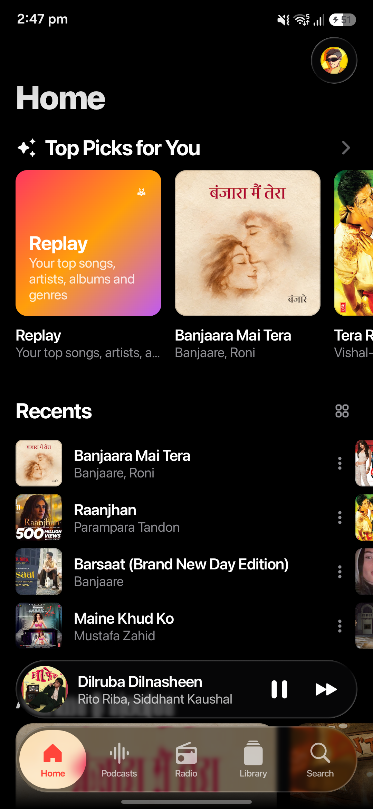
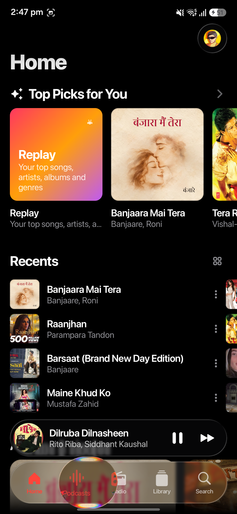
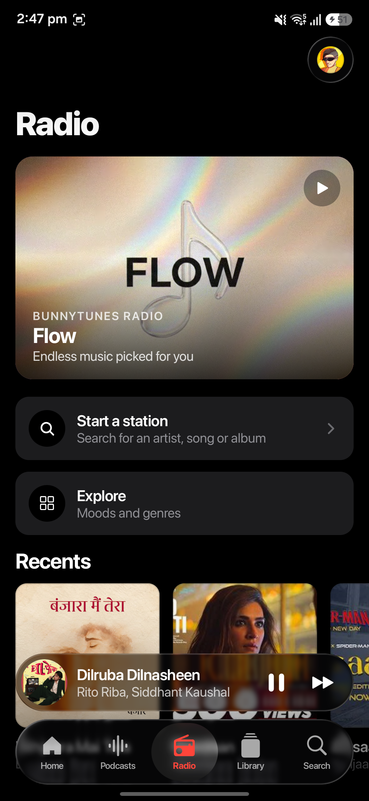
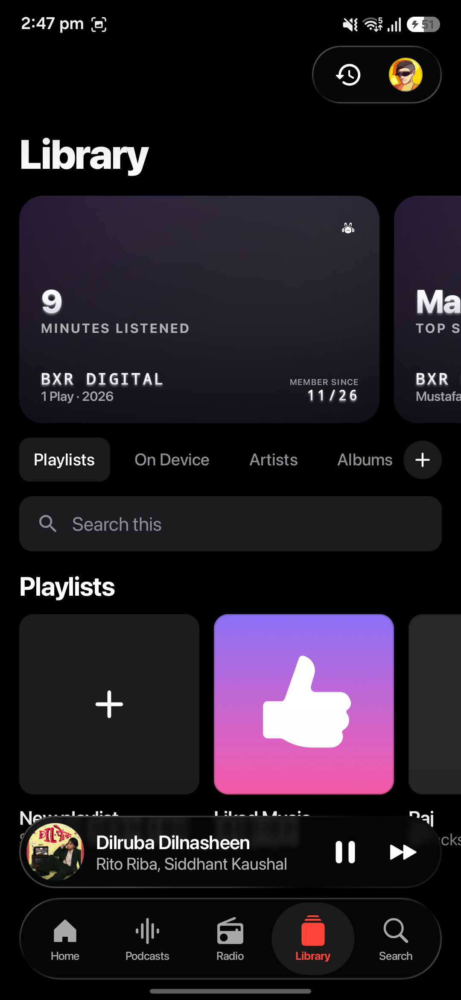
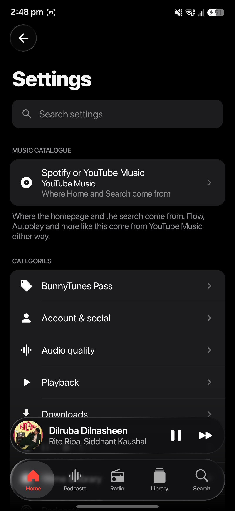
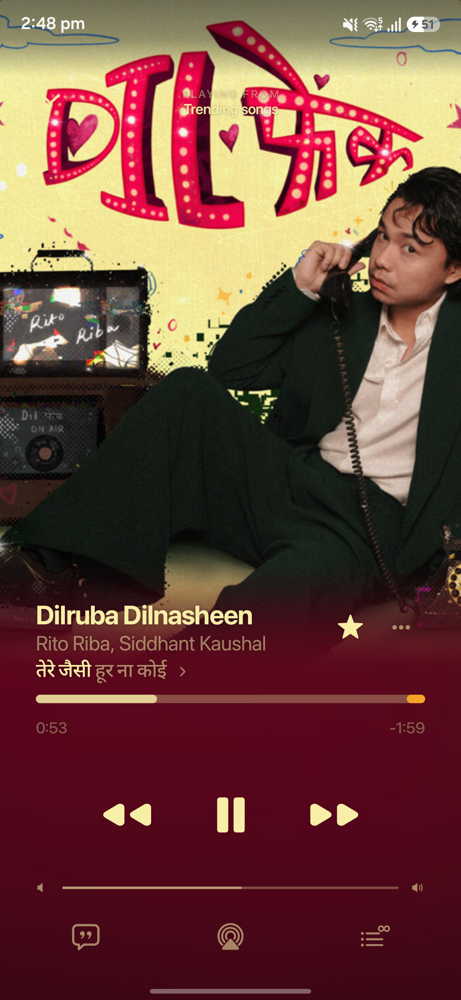
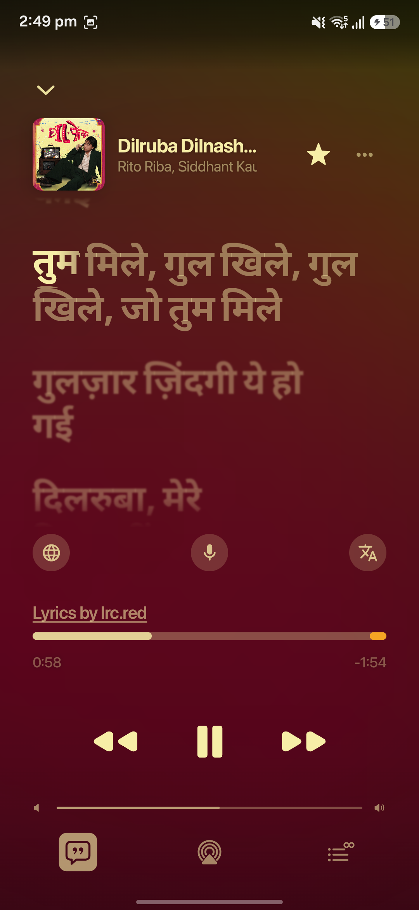
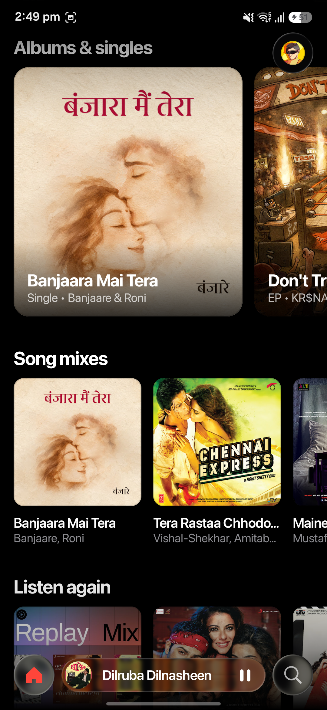

<div align="center">


# BunnyTunes V2
### Minimal Monochrome Liquid Glass Music Client for Android

[](https://rajvdalvi.github.io/BunnyTunes/)
[](https://github.com/rajvdalvi/BunnyTunes/releases)
[](#-installation--downloads)
[](LICENSE)
[](https://github.com/rajvdalvi/BunnyTunes/releases/tag/v2.0)
[](https://github.com/rajvdalvi)

A clean, ad-free Android music streaming client designed around a monochrome **Liquid Glass aesthetic**, fluid transitions, lossless audio streaming, live synced lyrics & translation, **BunnyTunes Pass**, and **Spotify playlist import**.

[**Download Android APK**](https://github.com/rajvdalvi/BunnyTunes/releases/download/v2.0/BunnyTunes-V2.apk) • [**Live Showcase**](https://rajvdalvi.github.io/BunnyTunes/) • [**Screenshots**](#-screenshots) • [**Installation**](#-installation--downloads)

---

</div>

## 📱 Screenshots

<div align="center">

### 1. Home, Liquid Glass Dock, Radio & Library
<table>
  <tr>
    <td align="center" width="25%">
      
      <br />
      <b>01. Home &amp; Top Picks</b>
      <br />
      <sub>Replay card, Recents &amp; liquid dock</sub>
    </td>
    <td align="center" width="25%">
      
      <br />
      <b>02. Liquid Glass Lens</b>
      <br />
      <sub>Refracting dock lens transition</sub>
    </td>
    <td align="center" width="25%">
      
      <br />
      <b>03. BunnyTunes Radio</b>
      <br />
      <sub>Flow glass station &amp; moods</sub>
    </td>
    <td align="center" width="25%">
      
      <br />
      <b>04. Library &amp; Stats</b>
      <br />
      <sub>Minutes listened &amp; playlists</sub>
    </td>
  </tr>
</table>

### 2. Settings, Full-Bleed Player, Synced Lyrics & Albums
<table>
  <tr>
    <td align="center" width="25%">
      
      <br />
      <b>05. Settings &amp; Pass</b>
      <br />
      <sub>BunnyTunes Pass &amp; catalogue</sub>
    </td>
    <td align="center" width="25%">
      
      <br />
      <b>06. Now Playing</b>
      <br />
      <sub>Edge-to-edge canvas &amp; scrubber</sub>
    </td>
    <td align="center" width="25%">
      
      <br />
      <b>07. Synced Lyrics</b>
      <br />
      <sub>Word-synced Devanagari &amp; translate</sub>
    </td>
    <td align="center" width="25%">
      
      <br />
      <b>08. Albums &amp; Mixes</b>
      <br />
      <sub>Large cards, mixes &amp; Replay</sub>
    </td>
  </tr>
</table>

</div>

---

## ✨ What's New in V2 (`v2.0`)

- **Complete BunnyTunes Rebrand:** Installed launcher name is **`BunnyTunes`**, Settings shows **`BunnyTunes v2.0`** (`Developer: Raj Dalvi`), plus **BunnyTunes Pass** (`bunnytunes.app`), **BunnyTunes Radio**, and **BunnyTunes Replay** with zero legacy upstream branding.
- **Redesigned Black & White Liquid Glass Logo:** Custom monochrome adaptive launcher foreground, themed monochrome icon (`#070709` obsidian glass backdrop), and crisp SVG marks.
- **Fixed Spotify Playlist Import:** Resolved anonymous session token harvesting via fast OkHttp embed fallback for 100+ track playlists and added support for `spotify.link` / `spoti.fi` shortlinks, share text, and bare playlist IDs.
- **Resource & Stability Fixes:** Recomputed all 4,432 Compose Multiplatform `.cvr` resource offsets with zero errors and verified APK v2/v3 release signatures.

---

## 📥 Installation & Downloads

### 🤖 Android (Direct APK)
1. Download **`BunnyTunes-V2.apk`** (`83.67 MB`) from [GitHub Releases](https://github.com/rajvdalvi/BunnyTunes/releases/download/v2.0/BunnyTunes-V2.apk).
2. Open the `.apk` on your Android device and tap **Install**.
3. *Alternative (ADB):*
   ```bash
   adb install -r BunnyTunes-V2.apk
   ```

| Asset | Platform | Type | Size | SHA-256 Checksum |
|:---|:---:|:---:|:---:|:---|
| **BunnyTunes-V2.apk** | Android 8.0+ | Signed APK | 83.67 MB | `42df74211c9719a44d9d62ccfbd22d6c0ffb1ff369b984e69ef173fe89179df8` |

---

## 🛠️ Tech Stack & Architecture

- **UI Framework:** Jetpack Compose (Material 3) & Compose Multiplatform
- **Audio Engine:** AndroidX Media3 / ExoPlayer with Lossless PCM & Spatial/Dolby Atmos support
- **Package Name:** `com.dev.bitchord` (`versionCode 200`, `versionName 2.0`)
- **Min / Target SDK:** Android 8.0 (API 26) / Target API 36
- **Security:** Signed with **APK Signature Scheme v2 & v3**

---

<div align="center">
Built &amp; maintained by <b>Raj Dalvi</b> · Licensed under <a href="LICENSE">GPL-3.0</a>
</div>
