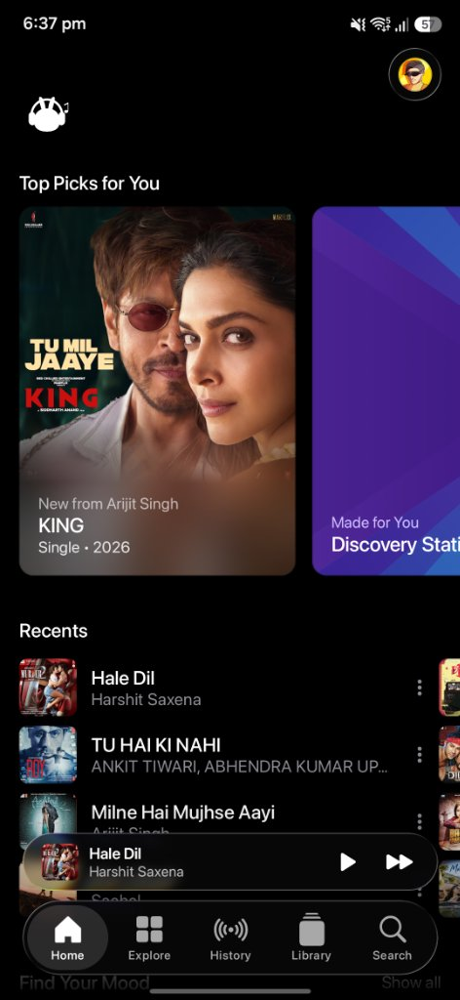
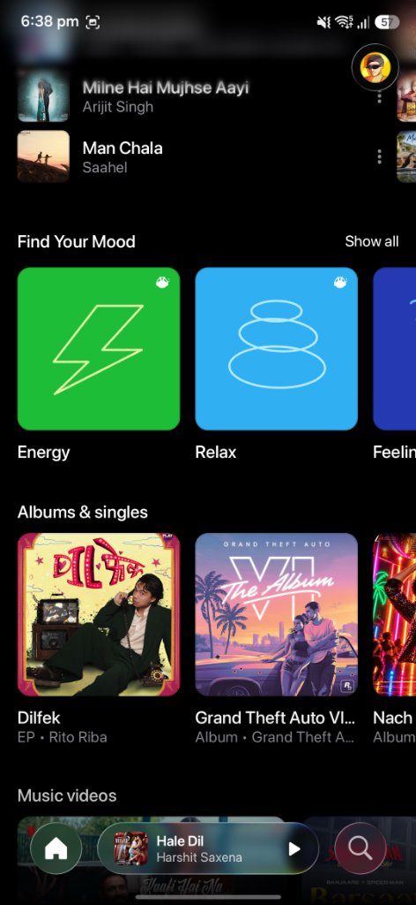
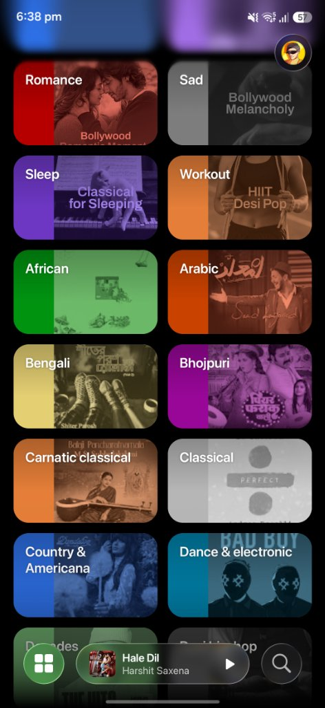
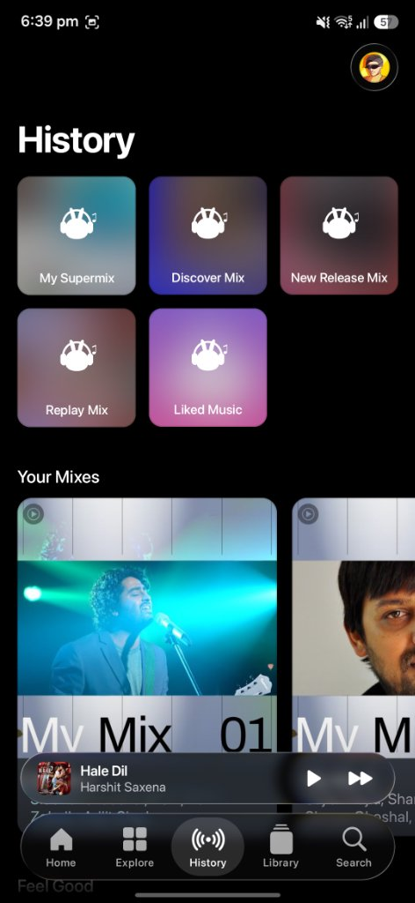
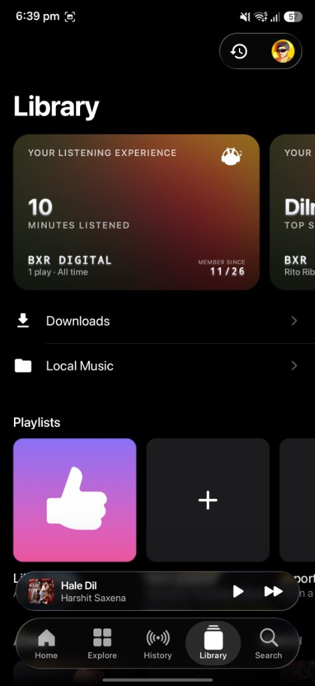
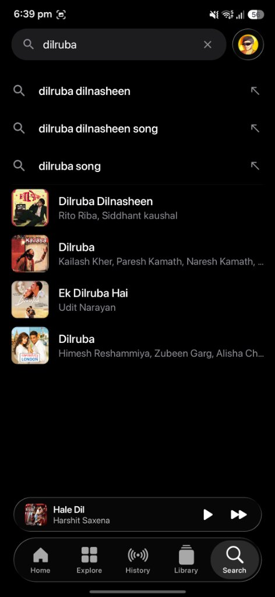
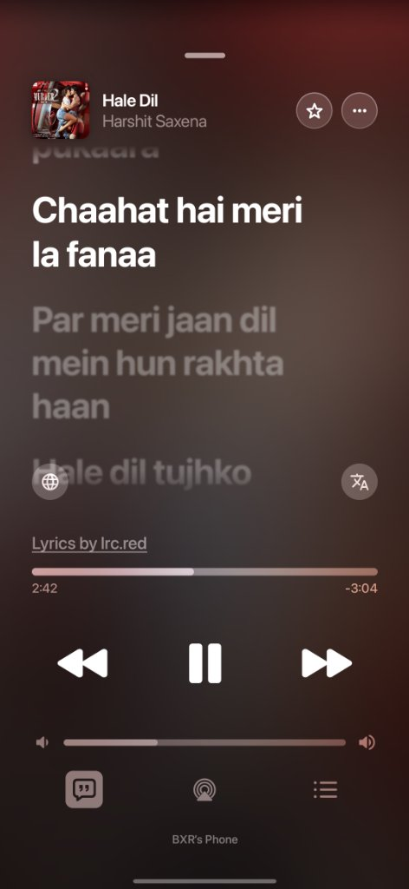
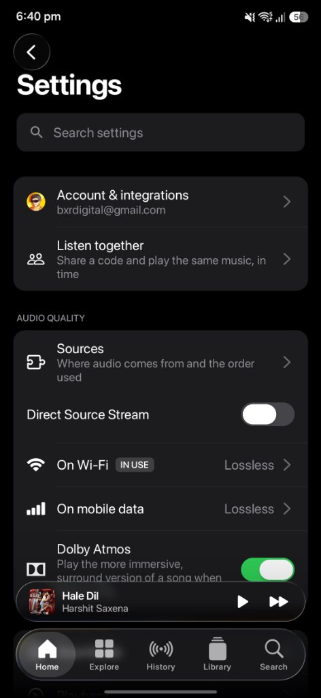
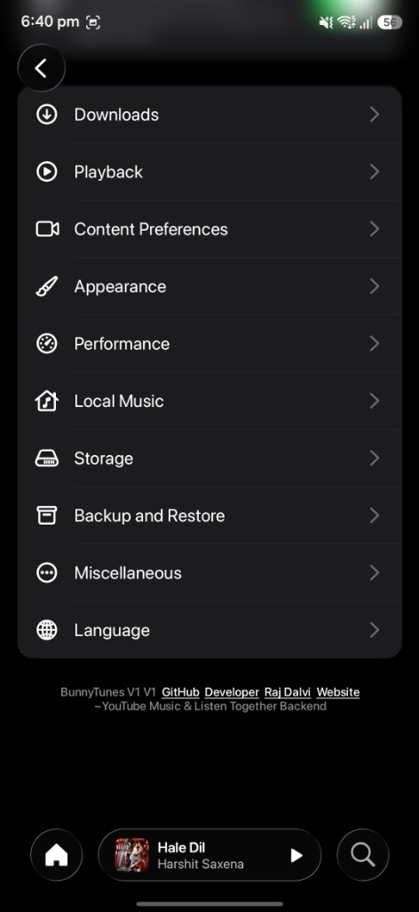

<div align="center">

# 🐰 Bunny Tunes
### Premium Music & Streaming Client for Android

[](https://rajvdalvi.github.io/BunnyTunes/)
[](https://github.com/rajvdalvi/BunnyTunes/releases)
[](#-installation)
[](LICENSE)
[](https://github.com/rajvdalvi/BunnyTunes/releases)
[](#key-features)
[](https://github.com/rajvdalvi)

A stunning, ad-free music streaming app tailored with an **iOS Liquid Glass aesthetic**, smooth physics-based transition animations, lossless audio rendering, custom themes & changable icons, and curated trending Indian & Hindi music prioritization. Currently available for **Android** (Windows edition in development).

[**Download Android APK**](https://github.com/rajvdalvi/BunnyTunes/releases/download/v2.0/BunnyTunes-V2.apk) • [**Live Website**](https://rajvdalvi.github.io/BunnyTunes/) • [**Screenshots**](#-screenshots-sequential-app-flow) • [**Installation**](#-installation)

---

</div>

## 📱 Screenshots

<div align="center">

### 1. Home, Moods & Exploration
<table>
  <tr>
    <td align="center" width="33%">
      
      <br />
      <b>01. Home &amp; Top Picks</b>
      <br />
      <sub>Bunny emblem, curated Indian releases, quick recents &amp; dynamic dock</sub>
    </td>
    <td align="center" width="33%">
      
      <br />
      <b>02. Find Your Mood &amp; Albums</b>
      <br />
      <sub>Energy &amp; Relax mood cards with transparent Bunny badge</sub>
    </td>
    <td align="center" width="33%">
      
      <br />
      <b>03. Explore &amp; Genres</b>
      <br />
      <sub>Bollywood Romantic, Classical, Workout, Melancholy &amp; 30+ regional categories</sub>
    </td>
  </tr>
</table>

### 2. History, Library & Search
<table>
  <tr>
    <td align="center" width="33%">
      
      <br />
      <b>04. History &amp; Mixes</b>
      <br />
      <sub>Supermix, Discover Mix, Liked Music with Bunny branding &amp; artist reels</sub>
    </td>
    <td align="center" width="33%">
      
      <br />
      <b>05. Library &amp; Stats</b>
      <br />
      <sub>Listening minutes, BunnyTunes Listener status, downloads &amp; playlists</sub>
    </td>
    <td align="center" width="33%">
      
      <br />
      <b>06. Search &amp; Autocomplete</b>
      <br />
      <sub>Lightning-fast search across 100M+ Indian &amp; international tracks</sub>
    </td>
  </tr>
</table>

### 3. Now Playing & Settings
<table>
  <tr>
    <td align="center" width="33%">
      
      <br />
      <b>07. Now Playing &amp; Lyrics</b>
      <br />
      <sub>Apple Music liquid backdrop, real-time live synced lyrics &amp; bit-perfect scrubber</sub>
    </td>
    <td align="center" width="33%">
      
      <br />
      <b>08. Audio Quality &amp; Dolby Atmos</b>
      <br />
      <sub>Hi-Res Lossless Wi-Fi/Mobile streaming, Direct Source &amp; Spatial Dolby Atmos</sub>
    </td>
    <td align="center" width="33%">
      
      <br />
      <b>09. Preferences &amp; Credits</b>
      <br />
      <sub>Customizations, offline storage, performance &amp; developer credits to Raj Dalvi</sub>
    </td>
  </tr>
</table>

</div>

---

## ✨ Key Features

- **🌸 Liquid Glass:** Deep OLED frosted glass surfaces (`#0E0E11`), translucent control docks, and Apple Music-inspired ambient glows enabled right out of the box.
- **🎨 Changable In-App Themes & Icons:** Includes Neon Violet, Neon Cyan, Neon Silver, and Monochrome adaptive icon packs.
- **📜 Quick History Navigation:** Replaced radio menus with a seamless, direct **History** tab in the main navigation dock.
- **🎵 Lossless High-Fidelity Audio:** Configured for maximum stream bitrate (`Lossless`) and bit-perfect DAC pass-through support.
- **🇮🇳 Curated Hindi & Indian Priority:** Automated regional feed routing bringing trending Indian hits, Bollywood favorites, and regional charts directly to your Home feed.
- **⚡ Smooth iOS Animations:** Fluid deceleration curves and spring gestures mimicking Apple Music and iOS app store navigation.
- **🚫 100% Ad-Free & Private:** Zero audio interruptions, no tracking telemetry, and no mandatory account sign-in required.
- **🪶 Lightweight & Optimized:** Stripped of background wearable daemons, lowering total memory and battery footprint.

---

## 📥 Installation & Downloads

### 🤖 Android (Direct APK)
1. Download **`BunnyTunes-V2.apk`** (83.67 MB) from [GitHub Releases](https://github.com/rajvdalvi/BunnyTunes/releases/download/v2.0/BunnyTunes-V2.apk).
2. Open the downloaded `.apk` file on your Android device and tap **Install**.
3. *Alternative (ADB):*
   ```bash
   adb install -r BunnyTunes-V2.apk
   ```

### 🪟 Windows PC (In Active Development)
> [!NOTE]
> The single-file installer edition for Windows is currently being finalized and optimized. Currently, official releases on GitHub are for Android. Windows builds will be published once fully approved.

| Asset | Platform | Type | Size | SHA-256 Checksum |
|:---|:---:|:---:|:---:|:---|
| **BunnyTunes-V2.apk** | Android 8.0+ | Signed APK | 83.67 MB | `122593D45B643918E6777440CEFD5949DB76A88872E10750605BD7555A2405B6` |

---

## 🛠️ Tech Stack & Architecture

- **UI Framework:** Jetpack Compose (Material 3) with custom translucent glass shaders
- **Audio Engine:** AndroidX Media3 / ExoPlayer with Lossless PCM & DAC direct output
- **Minimum SDK:** Android 8.0 (API 26)
- **Target SDK:** Android 16 / 17 (API 36+)
- **Security:** Signed with modern **APK Signature Scheme v2 & v3**

---

## 👤 Developer & Credits

- **Developer:** **Raj Dalvi**
- **Inspiration:** Apple Music iOS design language & open-source Android audio engineering
- **License:** Distributed under the [GNU General Public License v3.0](LICENSE).

---

<div align="center">
Made with ❤️ by <b>Raj Dalvi</b>
</div>
